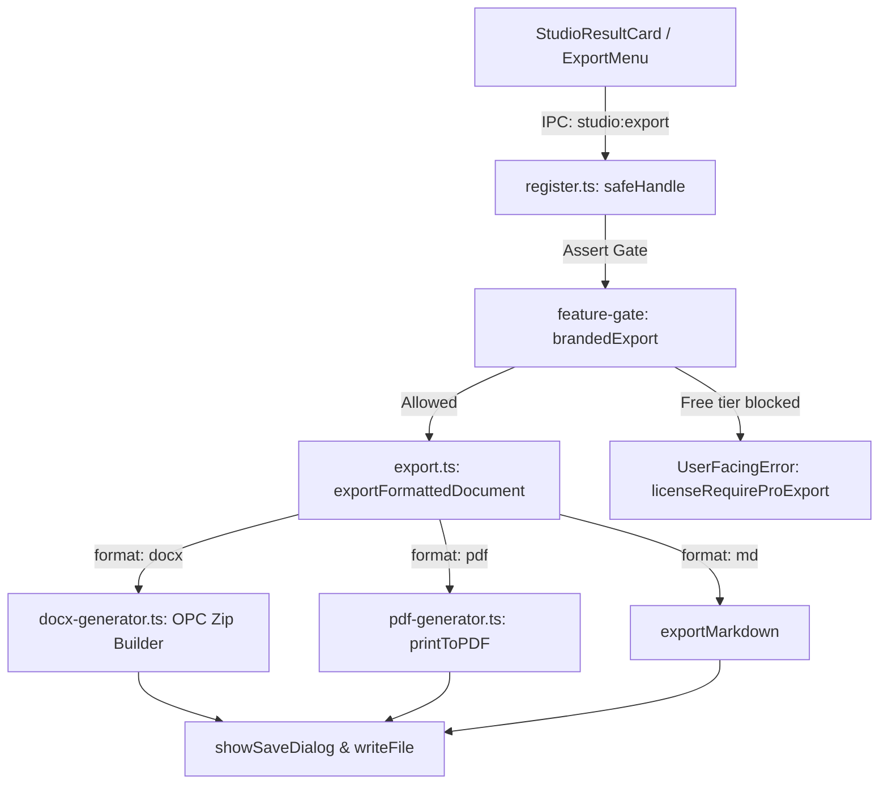

# Thiết Kế Cơ Bản: Xuất Báo Cáo Chuyên Nghiệp DOCX & PDF (Pro/Enterprise)

## 1. Tổng Quan Kiến Trúc
Tính năng `branded-export-docx-pdf` cung cấp khả năng xuất kết quả tổng hợp của AI Studio sang Microsoft Word (`.docx`) và tài liệu in ấn `PDF` chất lượng cao kèm thông tin định danh tổ chức (Branding), trang bìa, mục lục và chân trang số trang.

## 2. Kiểm Soát Bản Quyền (License Gating)
- **Feature Flag**: `"brandedExport"`
- Gói `free`: Chỉ cho phép `format === "md"`. Nếu chọn `format === "docx"` hoặc `format === "pdf"`, hệ thống ném mã lỗi `licenseRequireProExport`.
- Gói `pro` và `enterprise`: Mở khóa toàn bộ định dạng `docx`, `pdf`, `md`.

## 3. Tạo Tệp Word (.docx)
- Định dạng `.docx` là container ZIP tuân thủ chuẩn ISO/IEC 29500 (Open Packaging Conventions).
- Sử dụng module nén `node:zlib` và xử lý buffer thuần để tạo tệp ZIP không phụ thuộc binary ngoài:
  - `[Content_Types].xml`
  - `_rels/.rels`
  - `word/_rels/document.xml.rels`
  - `word/document.xml`
  - `word/styles.xml`
  - `word/header1.xml`
  - `word/footer1.xml`
- Chuyển đổi Markdown AST sang các phần tử WordprocessingML:
  - Heading 1, 2, 3 -> `<w:p><w:pPr><w:pStyle w:val="Heading1"/>...`
  - Bảng -> `<w:tbl>` với viền và căn lề tiêu chuẩn
  - Trích dẫn & Callout -> khối nền nổi bật
  - Header & Footer -> số trang tự động `<w:fldSimple w:instr="PAGE"/>`

## 4. Tạo Tệp PDF
- Sử dụng engine in Chromium tích hợp của Electron (`webContents.printToPDF`) qua BrowserWindow ẩn.
- Template HTML5 được inject style chuẩn văn phòng: font chữ sạch (sans-serif / serif), hỗ trợ UTF-8 tiếng Việt hoàn chỉnh, căn lề `@page { size: A4; margin: 20mm; }`, tiêu đề trang và số trang.
