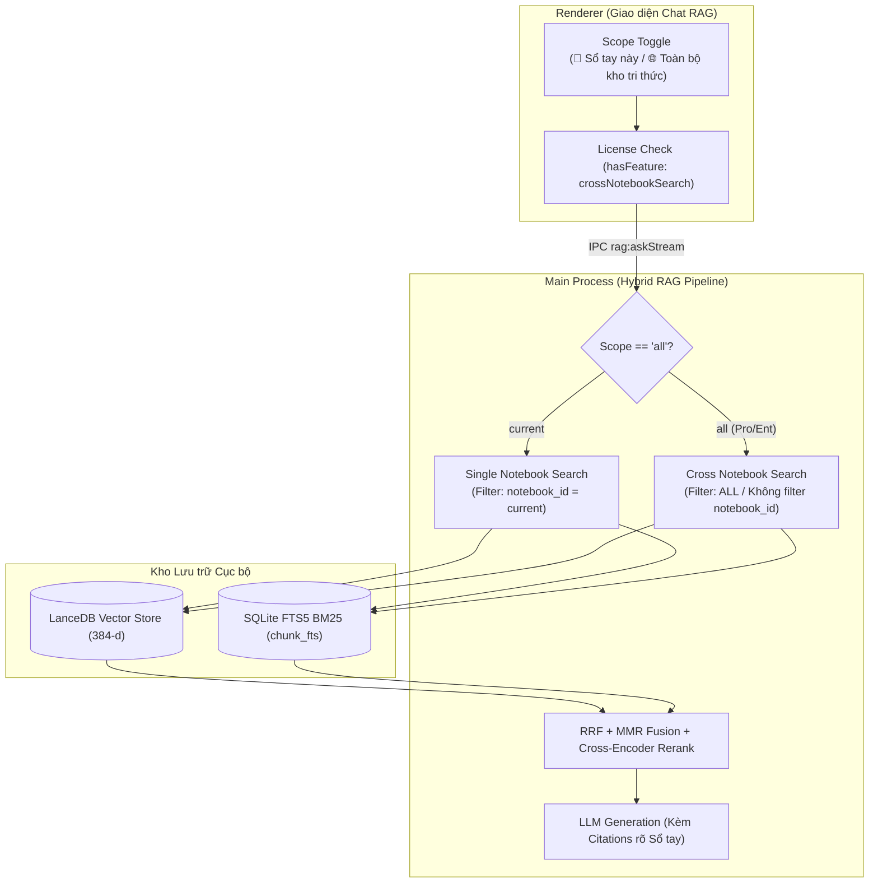

# Thiết kế Cơ bản: Tìm kiếm & Hỏi đáp RAG Toàn cục (`cross-notebook-search`)

**Ngày thiết kế**: 2026-10-24  
**Thuộc**: Lộ trình Nâng cấp Thương mại B2B/Pro — Hạng mục #231  
**Tài liệu liên quan**:
- [`docs/01-basic-design/enterprise-license/basic-design.md`](../enterprise-license/basic-design.md)
- [`docs/intake/013-rag-qa.md`](../../intake/013-rag-qa.md)
- [`docs/intake/055-rag-enhance.md`](../../intake/055-rag-enhance.md)
- [`.specify/memory/constitution.md`](../../../.specify/memory/constitution.md)

---

## 1. Mục tiêu & Bối cảnh

1. **Bối cảnh Khách hàng**:
   - Người dùng chuyên nghiệp (Luật sư, Bác sĩ, Nhà nghiên cứu) chia tài liệu thành nhiều Sổ tay theo từng vụ án, từng dự án hoặc từng ca lâm sàng.
   - Khi phát sinh câu hỏi tổng hợp mang tính so sánh hoặc tìm kiếm tiền lệ (ví dụ: *"Các vụ án năm 2024 có trường hợp nào tranh chấp quyền sử dụng đất tương tự không?"*), họ không thể mở từng sổ tay để gõ lại cùng một câu hỏi.
   - Họ cần khả năng chuyển đổi linh hoạt phạm vi tìm kiếm:
     - **Chế độ Sổ tay hiện tại (`current`)**: Hỏi đáp sâu trong tài liệu của sổ tay đang chọn.
     - **Chế độ Toàn bộ kho tri thức (`all`)**: RAG quét ngữ nghĩa trên tất cả sổ tay cùng lúc.

2. **Phân tầng Bản quyền**:
   - Chế độ toàn cục (`scope: "all"`) là tính năng nâng cao, chỉ mở khóa cho bản quyền **Pro** và **Enterprise** (cờ `crossNotebookSearch`).
   - Bản quyền Miễn phí (Free) chỉ được hỏi đáp trong phạm vi 1 sổ tay đang mở. Nếu người dùng Free bật chế độ "Toàn bộ kho tri thức", ứng dụng sẽ hiển thị hộp thoại yêu cầu nâng cấp Pro (`licenseRequireProCrossSearch`).

---

## 2. Kiến trúc Kỹ thuật

### Chi tiết Thực hiện:
1. **LanceDB Vector Search**:
   - `search(queryVector, notebookId | null, topK)`: Nếu `notebookId` là `null` hoặc `""`, câu lệnh truy vấn `.where(...)` sẽ bỏ qua điều kiện `notebook_id = '...'`.
2. **SQLite FTS5 BM25 Keyword Search**:
   - `searchBm25(notebookId | null, query, topK)`: Nếu `notebookId` là `null`, câu lệnh SQL sẽ không có mệnh đề `AND s.notebook_id = ?`.
3. **Citations với Metadata Sổ tay**:
   - Mỗi `Citation` bổ sung `notebookId` và `notebookName`. Khi hiển thị chip dẫn chứng trên UI: `[1] Sổ tay Pháp lý 2024 › Luat_Dat_Dai.pdf (Trang 12)`.
