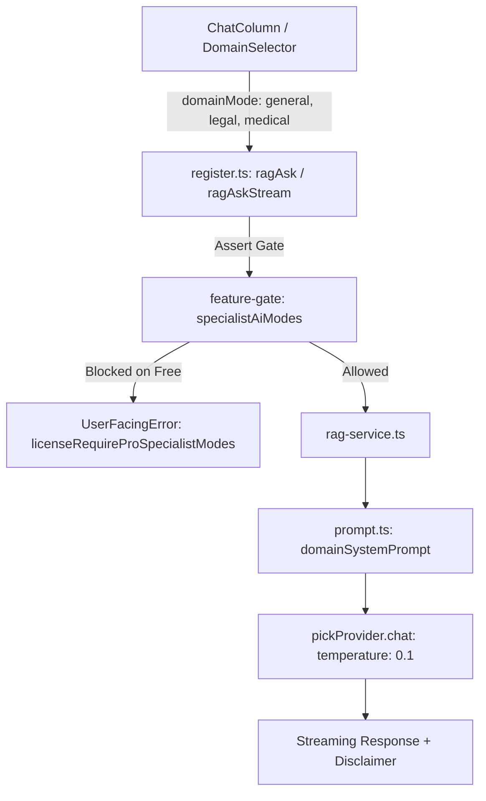

# Thiết Kế Cơ Bản: Chế Độ AI Chuyên Gia Cho Pháp Lý & Y Tế

## 1. Tổng Quan Kiến Trúc
Tính năng `domain-specific-ai-modes` nâng cấp khả năng lập luận của RAG Service và AI Runtime thông qua việc định hình nhân cách AI chuyên môn hóa (Domain Personas), siết chặt quy tắc căn cứ (Strict Grounding) và tự động điều chỉnh tham số sinh văn bản (Temperature = 0.1).

## 2. Kiểm Soát Bản Quyền (License Gating)
- **Feature Flag**: `"specialistAiModes"`
- Gói `free`: Chỉ cho phép `domainMode === "general"` (hoặc `undefined`). Khi gửi `domainMode === "legal"` hoặc `domainMode === "medical"`, hệ thống ném `licenseRequireProSpecialistModes`.
- Gói `pro` và `enterprise`: Toàn quyền kích hoạt chế độ Pháp lý và Y tế.

## 3. Quy Cách Chế Độ Chuyên Ngành
1. **Pháp lý (`legal`)**:
   - System Prompt: Đóng vai Chuyên gia Pháp chế và Rà soát Hợp đồng cấp cao.
   - Trích dẫn: Yêu cầu định vị rõ Điều, Khoản, Điểm nếu ngữ cảnh có đề cập.
   - Sampling: `temperature = 0.1` triệt tiêu sự ngẫu nhiên.
2. **Y tế (`medical`)**:
   - System Prompt: Đóng vai Chuyên gia Phân tích Bằng chứng Lâm sàng & Y Dược.
   - Cảnh báo: Tự động đính kèm thông báo miễn trừ trách nhiệm y khoa.
   - Sampling: `temperature = 0.1`.
3. **Chung (`general`)**:
   - Áp dụng các prompt hiện tại của ứng dụng.
