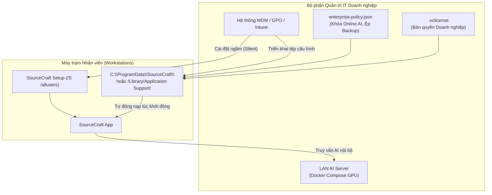

# Thiết kế Cơ bản: Đóng gói Triển khai Doanh nghiệp (`enterprise-packaging`)

**Ngày thiết kế**: 2026-10-24  
**Thuộc**: Lộ trình B2B Enterprise — Pha 4 (tiếp nối `226-enterprise-license`, `228-lan-ai-and-policy`, `229-shared-team-notebooks`)  
**Tài liệu liên quan**:
- [`docs/01-basic-design/enterprise-license/basic-design.md`](../enterprise-license/basic-design.md)
- [`docs/01-basic-design/lan-ai-and-policy/basic-design.md`](../lan-ai-and-policy/basic-design.md)
- [`docs/01-basic-design/shared-team-notebooks/basic-design.md`](../shared-team-notebooks/basic-design.md)
- [`.specify/memory/constitution.md`](../../../.specify/memory/constitution.md)

---

## 1. Mục tiêu & Bối cảnh

1. **Bối cảnh Khách hàng Doanh nghiệp**:
   - Khi triển khai ứng dụng cho hàng chục hoặc hàng trăm máy trạm nhân viên, đội ngũ IT không thể thao tác cài đặt thủ công từng máy. Họ cần cơ chế cài đặt tự động ngầm (Silent Install) tương thích với các giải pháp quản lý thiết bị tập trung (MDM) như Microsoft Intune, SCCM, Group Policy (GPO) trên Windows hoặc Jamf Pro / Munki trên macOS.
   - Doanh nghiệp yêu cầu ứng dụng phải tự động nạp chính sách bảo mật (`enterprise-policy.json`) và giấy phép (`.sclicense`) được cấp phát sẵn từ thư mục hệ thống chuẩn mà không yêu cầu nhân viên phải cấu hình.
   - Doanh nghiệp cần hạ tầng máy chủ AI nội bộ (LAN AI Server) có thể dựng nhanh chóng bằng Docker container chạy trên cụm GPU riêng trong mạng nội bộ.

2. **Mục tiêu kỹ thuật**:
   - Tinh chỉnh cấu hình `electron-builder.yml` của NSIS Installer để hỗ trợ tham số cài đặt diện rộng `/allusers`, `/S` và đường dẫn cài đặt mặc định vào thư mục hệ thống.
   - Cung cấp tệp mẫu `deployment/enterprise-policy.json.example` sẵn sàng cho IT quản trị viên áp dụng.
   - Cung cấp bộ cấu hình container `deployment/docker-compose.lan-ai.yml` đóng gói máy chủ AI nội bộ (Ollama & vLLM) kèm Nginx xác thực Token nội bộ.
   - Soạn thảo Hướng dẫn Triển khai Doanh nghiệp toàn diện (`docs/enterprise-deployment-guide.md`).

---

## 2. Ranh giới Bảo mật & Ràng buộc Bất biến

- **Local-first & No Default Egress (Constitution Principle I)**: Toàn bộ quá trình đóng gói và triển khai không phụ thuộc vào bất kỳ dịch vụ đám mây bên ngoài nào.
- **Desktop Security Boundary (Constitution Principle III)**: Các tệp cấu hình chính sách hệ thống được lưu ở vị trí chỉ quản trị viên hệ thống có quyền ghi (`/Library/Application Support/SourceCraft/` hoặc `C:\ProgramData\SourceCraft\`). Ứng dụng chỉ đọc và áp dụng chính sách, ngăn chặn nhân viên tự ý vô hiệu hóa chính sách an toàn.
- **Tương thích ngược (Backward Compatibility)**: Người dùng cá nhân tải bản cài đặt thông thường vẫn có thể cài đặt độc lập theo chế độ người dùng hiện tại (per-user) mà không cần quyền Administrator.

---

## 3. Kiến trúc Triển khai Doanh nghiệp

