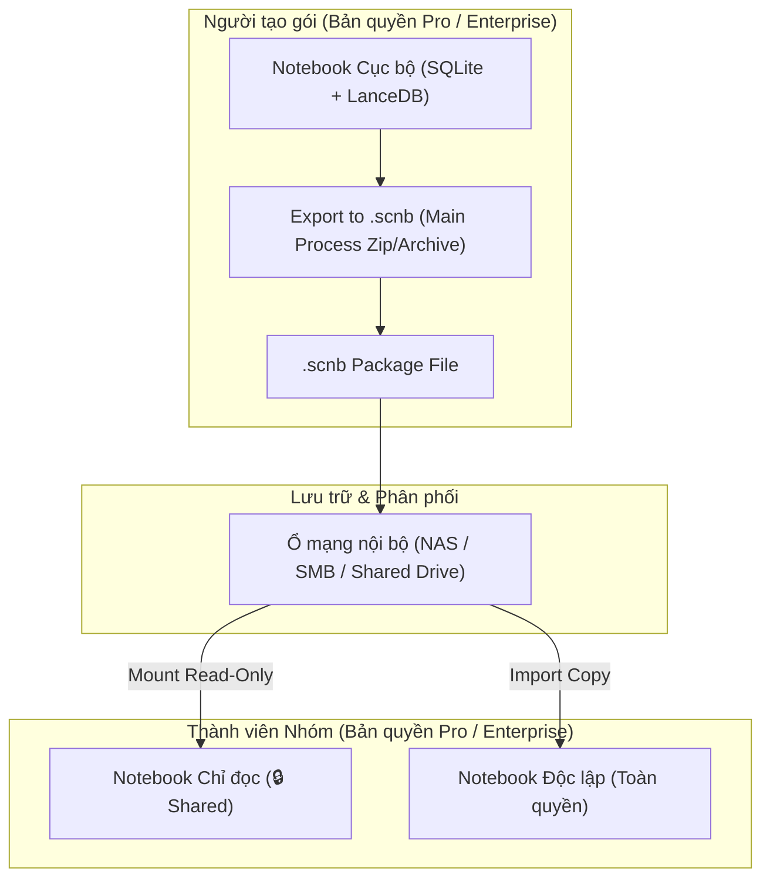

# Thiết kế Cơ bản: Gói Sổ tay Tri thức Dùng chung (`shared-team-notebooks`)

**Ngày thiết kế**: 2026-10-24  
**Thuộc**: Lộ trình B2B Enterprise — Pha 3 (tiếp nối `226-enterprise-license` và `228-lan-ai-and-policy`)  
**Tài liệu liên quan**:
- [`docs/01-basic-design/enterprise-license/basic-design.md`](../enterprise-license/basic-design.md)
- [`docs/01-basic-design/lan-ai-and-policy/basic-design.md`](../lan-ai-and-policy/basic-design.md)
- [`.specify/memory/constitution.md`](../../../.specify/memory/constitution.md)

---

## 1. Mục tiêu & Bối cảnh

1. **Bối cảnh Khách hàng**:
   - Các doanh nghiệp và người dùng chuyên nghiệp (Pro) thường cần phân phối kho tài liệu/tri thức chuẩn hóa (Sổ tay nhân viên, Quy trình ISO, Tài liệu dự án, Cơ sở dữ liệu tiền lệ án) cho nhóm làm việc hoặc thành viên trong tổ chức.
   - Thay vì phải chia sẻ từng tệp lẻ và yêu cầu mỗi máy tự tạo notebook rồi index lại từ đầu (tốn thời gian và tài nguyên CPU/GPU), họ cần một cơ chế đóng gói hoàn chỉnh: **cả nội dung, metadata, chunk và vector nhúng sẵn** vào một tệp gói tri thức `.scnb` (SourceCraft Notebook Package).
   - **Phân tầng bản quyền**:
     - Tính năng Xuất bản gói tri thức (`exportPackage`) và Nhập/Gắn kết gói tri thức dùng chung (`importPackage` / `mountPackage`) là **tính năng nâng cao**, yêu cầu bản quyền **Pro** hoặc **Enterprise** (`sharedNotebooks`). Gói Free (Community) không được phép xuất/gắn kết gói tri thức dùng chung.

2. **Mục tiêu kỹ thuật**:
   - **Định dạng Gói Tri thức `.scnb` (SourceCraft Notebook Package)**:
     - Tệp nén `.scnb` (sử dụng ZIP / TAR nội bộ hoặc JSON container kèm thư mục) chứa:
       - `manifest.json`: Thông tin notebook (`id`, `name`, `description`, `author`, `version`, `createdAt`, `checksum`).
       - `sources.json`: Danh sách nguồn tài liệu (`title`, `kind`, `charCount`, `tokenCount`).
       - `chunks.json`: Toàn bộ các đoạn trích (`chunks`) phục vụ BM25 FTS5 và tái hiện nội dung.
       - `vectors.bin` (hoặc vector records): Các vector nhúng 384-chiều (`multilingual-e5-small`) đi kèm để máy nhận có thể hỏi đáp RAG ngay lập tức mà không cần tính toán lại.
   - **Hai chế độ Sử dụng Gói Tri thức**:
     - **Chế độ 1 — Nhập bản sao độc lập (Import as Independent Copy)**: Giải nén và nạp notebook vào cơ sở dữ liệu SQLite & LanceDB cục bộ của người dùng. Người dùng có toàn quyền đọc, sửa, thêm nguồn mới.
     - **Chế độ 2 — Gắn kết Chỉ đọc (Mount Read-Only / Shared Team Vault)**: Trỏ tới tệp `.scnb` hoặc thư mục notebook được lưu trên ổ đĩa mạng nội bộ (SMB/NAS/LAN Shared Folder). Notebook hiển thị huy hiệu 🔒 **"Dùng chung (Chỉ đọc)"**, nhân viên có thể tìm kiếm, hỏi đáp RAG và chạy Studio nhưng không được sửa hay xóa dữ liệu gốc, tự động cập nhật khi tệp trên ổ mạng được cập nhật.

---

## 2. Ranh giới Bảo mật & Ràng buộc Bất biến

- **Local-first 100% (Constitution Principle I)**: Việc xuất/nhập/gắn kết gói `.scnb` diễn ra hoàn toàn trên hệ thống tệp cục bộ hoặc ổ đĩa mạng nội bộ mà máy có quyền truy cập, không có bất kỳ kết nối mạng ra bên ngoài.
- **Desktop Security Boundary (Constitution Principle III)**: Hộp thoại chọn tệp/thư mục lưu gói `.scnb` được mở hoàn toàn ở Main process (`dialog.showSaveDialog` / `dialog.showOpenDialog`). Renderer không thể truyền đường dẫn tệp bất kỳ.
- **Kiểm tra Bản quyền (`FeatureGate`)**:
   - Cập nhật `DEFAULT_PRO_FEATURES` để bao gồm `sharedNotebooks`.
   - Main process kiểm tra: nếu `!gate.hasFeature("sharedNotebooks")`, ném lỗi `UserFacingError("licenseRequireProSharedNotebooks")`.

---

## 3. Kiến trúc Luồng Dữ liệu (Package Pipeline)

