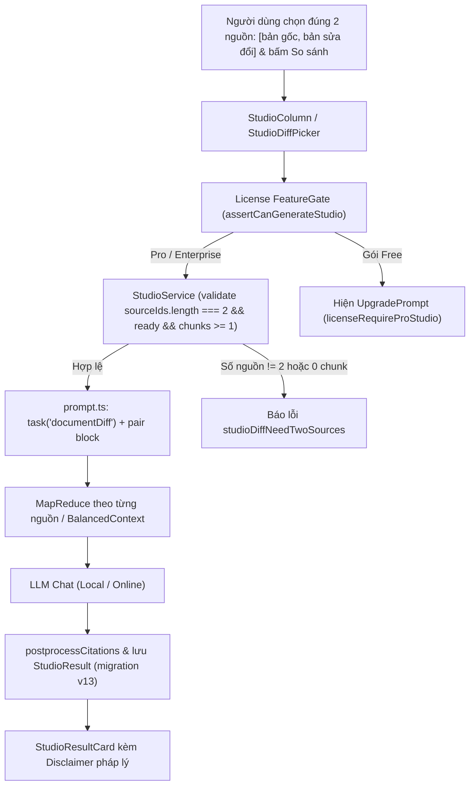

# Design Intake: Document Diff & Contract Redline (233)

## 1. Mục tiêu kiến trúc
Cung cấp khả năng phân tích so sánh đối chiếu văn bản tự động (Document Diff / Contract Redline) trong AI Studio của SourceCraft, phục vụ người dùng khối Pháp lý, Doanh nghiệp và Quản lý dự án.

## 2. Luồng xử lý (Workflow)

## 3. Ràng buộc & Tiêu chuẩn
- Tuân thủ nguyên tắc **Local-first** và **Verifiable Citations (Constitution II)**: Mọi nhận định về thay đổi, điều khoản thêm/bớt đều phải mang chip trích dẫn `[n]` trỏ về chunk gốc tương ứng.
- Đúng 2 nguồn có vai trò rõ ràng: `sourceIds[0]` = bản gốc, `sourceIds[1]` = bản sửa đổi.
- Bảng Markdown GFM 4 cột ở mục 4 (sửa đổi & rủi ro).
- Hoàn toàn ngoại tuyến (Zero Network Egress khi chạy với Ollama/LAN AI).
- Gated bởi bản quyền Pro/Enterprise.
